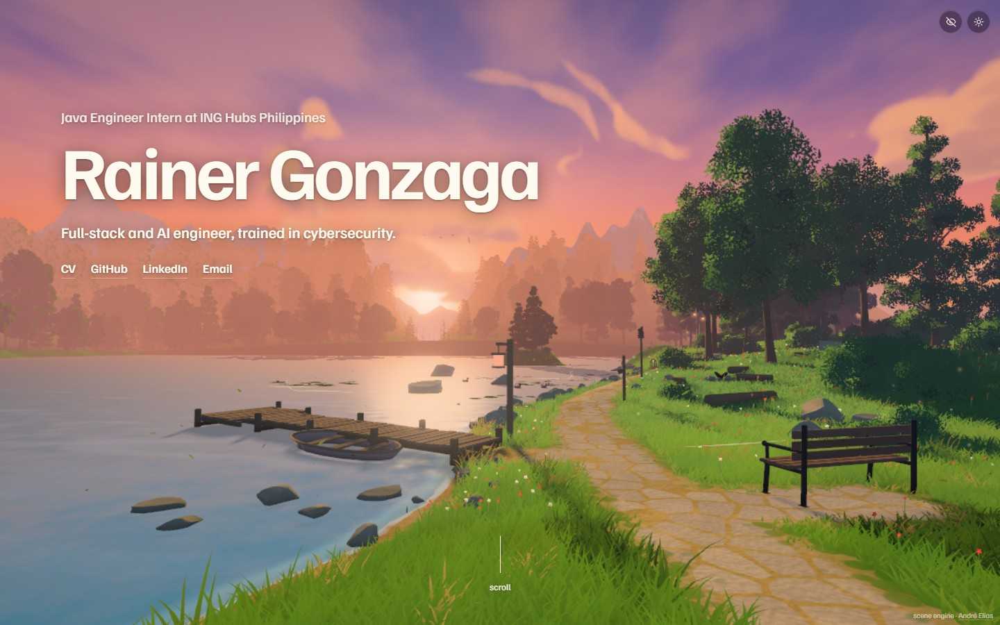

# raigon

My portfolio at [raigon.dev](https://www.raigon.dev). A CV sheet in frosted glass floats over a 3D lake you walk along as you scroll.

## Features

- **Lake scene** in three.js: the camera walks the path as you scroll, with sunset and morning lighting
- **Low-end fallback**: weak GPUs, software renderers and reduced motion get a still image instead of the live scene
- **Hide the page** to look at the lake
- **Parc Fermé case study** at `/work/parc-ferme`, with a live line pulled from [f1.raigon.dev](https://f1.raigon.dev)
- **Contact form** through Web3Forms
- **Security headers**: CSP, HSTS, frame and permissions policies, plus `/.well-known/security.txt`
- **Generated Open Graph images** for the home page and the case study

## Stack

- Next.js 16 (App Router), React 19, TypeScript
- three.js
- Vitest, ESLint, GitHub Actions CI
- Vercel, with Web Analytics

Scene engine by [André Elias](https://www.andreelias.dev/en).
